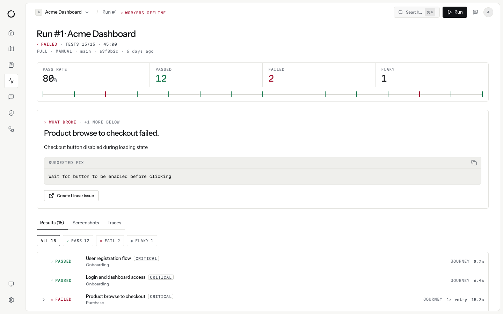

<picture>
  <source media="(prefers-color-scheme: dark)" srcset=".github/readme/hero-dark.svg">
  
</picture>

<p align="center">
  <a href="#self-host-it">Self-host it</a> ·
  <a href="#how-it-works">How it works</a> ·
  <a href="#develop-locally">Develop locally</a> ·
  <a href="docs/setup-guide.md">Setup guide</a>
</p>

Orbit reads a pull request's diff, works out which user journeys it touches, and walks those journeys in a
real browser on the PR's preview deployment. What broke lands on the PR as a GitHub check, in plain English,
with the recording and the step that failed. It runs on your infrastructure with your own model key.
Source-available under the O'Saasy License: free to use, self-host and modify.



## Self-host it

Orbit is one web service plus Postgres (with pgvector), Redis and a headless browser.

### Docker Compose

```bash
git clone https://github.com/naramalhasaniWork/orbit.git
cd orbit
cp .env.selfhost.example .env     # fill in secrets, GitHub App and a model key
docker compose up -d
```

This starts `web`, `postgres` (pgvector), `redis` and `browser` (browserless). Then:

1. Open the app. A new instance sends you to **`/setup`**, a checklist that tests the database, Redis, the
   browser, your secrets, the GitHub App and the model key. Each red item names the variable to set.
2. Create the GitHub App (below) and fill in its variables.
3. Sign in with GitHub. **The first person to sign in becomes the admin**, and `/setup` closes.
4. Connect a repository and open a pull request.

### Railway

Create the services in [docs/self-hosting/railway.md](docs/self-hosting/railway.md), then follow
[docs/self-hosting/first-run.md](docs/self-hosting/first-run.md). It takes about 20 minutes, most of it
creating the GitHub App.

### The GitHub App

One GitHub App handles both sign-in and repository access. A plain OAuth App won't work.

| Setting | Value |
|---|---|
| Callback URL | `<NEXTAUTH_URL>/api/auth/callback/github` |
| Setup URL | `<NEXTAUTH_URL>/api/github/installations/callback` |
| Request user authorization (OAuth) during installation | On |

Copy its client ID and secret, app ID, slug and private key into `GITHUB_CLIENT_ID`,
`GITHUB_CLIENT_SECRET`, `GITHUB_APP_ID`, `GITHUB_APP_SLUG` and `GITHUB_APP_PRIVATE_KEY`.

### Required variables

| Variable | What it is |
|---|---|
| `DATABASE_URL` | Postgres with the pgvector extension. |
| `REDIS_URL` | Redis, for BullMQ queues and pub/sub. |
| `NEXTAUTH_URL` | The app's public URL. |
| `NEXTAUTH_SECRET` | Session signing secret. |
| `ENCRYPTION_KEY` | Encrypts stored secrets. Losing it makes them unreadable. |
| `GITHUB_*` | The GitHub App, above. |
| `ANTHROPIC_API_KEY`, `OPENAI_API_KEY` or `OPENROUTER_API_KEY` | At least one model provider. `ORBIT_AI_KEYS=byok` lets each workspace bring its own instead. |
| `PLAYWRIGHT_WS_ENDPOINT` | A remote browser (browserless). Falls back to local Chromium when unset. |

Generate the two secrets:

```bash
echo "NEXTAUTH_SECRET=$(openssl rand -base64 32)"; echo "ENCRYPTION_KEY=$(openssl rand -hex 32)"
```

Everything else is optional and documented in [`.env.example`](.env.example): storage (`STORAGE_PROVIDER`
`local`, `s3` or `r2`), embeddings (`ORBIT_EMBEDDINGS`), Linear, Slack, GitLab, email, and `ORBIT_*`
deployment flags. The container applies migrations on start. Health check: `GET /api/health`, which returns
503 naming the dependency that failed.

## How it works

1. **Map.** Routes, components, API calls and data models become a dependency graph (tree-sitter), rebuilt on every push.
2. **Scope.** On a pull request, the changed files are walked up the graph to the journeys a user would notice.
3. **Run.** A real Chromium walks each journey on the PR's preview: Railway PR environments or Cloudflare Pages, including behind Cloudflare Access.
4. **Explain.** One GitHub check with the cause, the step it failed at, screenshots and a suggested fix. Linear and Slack too, if you connect them.
5. **Replay.** A case's first passing run is compiled into a script. Later runs replay it with zero model calls.

<picture>
  <source media="(prefers-color-scheme: dark)" srcset=".github/readme/architecture-dark.svg">
  
</picture>

Web and workers run in one process by default. Set `ORBIT_ROLE=web` on one container and
`ORBIT_ROLE=worker` on another to split them.

| Area | Code |
|---|---|
| Indexing: clone, framework detection, tree-sitter, System Map | `src/services/indexing/` |
| Planning: journeys, prioritised cases, diff scoping | `src/services/planning/` |
| Execution: one case runner, Playwright over CDP, compile-and-replay | `src/server/engine/`, `src/services/execution/` |
| Reporting: failure analysis, GitHub checks, Linear, Slack | `src/services/reporting/` |
| Previews: Railway and Cloudflare Pages discovery | `src/services/preview/` |
| MCP: a server for coding agents, and MCP tools callable during a test | `src/services/mcp/` |

### Compile-and-replay

The first passing run of a browser case is compiled into a replay script: one resolved action per step,
with css, role and name, test-id or text locators, and an assertion for every step. If a step has no
assertion of its own, one cheap model call derives one, and it must already hold on the page captured after
that step. A case with any step still lacking an assertion stays agent-only.

Later runs replay the script with no model calls. When a step diverges, the agent takes over the live page
from that step, and a passing heal is saved as the next script version. Scripts are keyed by environment,
role and viewport, and ignored once the case's steps change. Scripts covering changed code are marked
`suspect`. The agent re-verifies 1 in 20 replays and any script it hasn't verified in 14 days. Replay is
benched for a case when more than 3 of its last 10 replays diverged.

- `GET /api/admin/execution-cost?since=<ISO>`: model calls and estimated cost per 100 executions, by mode.
- `GET /api/projects/:id/test-cases/:caseId/script.spec.ts`: export a script as a Playwright test.

### How it compares

| | Orbit | Playwright with an AI agent | Hosted AI QA services |
|---|---|---|---|
| Who writes the tests | Planned from the code map; you review and edit | You, with the agent helping | The vendor's agent, from your UI |
| What runs on a PR | Journeys the diff can reach | Your whole suite, or what you select | Usually the whole suite, or a schedule |
| Where it runs | Your infrastructure | Your CI | Their cloud |
| Your code leaves your infra | No | No | Typically yes, or the app is crawled |
| Model cost | Your key, shown per run; replays cost nothing | Your key, while authoring | Bundled into their price |
| When the UI changes | The agent heals the step and saves a new version | You update selectors and specs | The vendor's agent |

## Develop locally

You need Node 20, pnpm, PostgreSQL 16+ with pgvector, and Redis.

```bash
git clone https://github.com/naramalhasaniWork/orbit.git
cd orbit
pnpm install
cp .env.example .env.local     # fill in the required variables
pnpm db:migrate:deploy
pnpm dev                       # http://localhost:3000, workers start in-process
pnpm db:seed                   # optional demo data
```

`pnpm workers` runs the workers on their own. Don't run it alongside a dev server that also runs them.

| Command | What it does |
|---|---|
| `pnpm dev` | Dev server, with workers |
| `pnpm build` / `pnpm start` | Production build and server |
| `pnpm test` | Vitest |
| `pnpm lint` | ESLint |
| `pnpm db:migrate` | Create and apply a migration (dev) |
| `pnpm db:migrate:deploy` | Apply pending migrations (production) |
| `pnpm db:migrate:status` | Show which migrations have run |
| `pnpm db:studio` | Prisma Studio |

> [!IMPORTANT]
> Change the schema only through `pnpm db:migrate`, never `db push` against a shared database. Read the
> generated SQL before committing: it must never `DROP INDEX` the search indexes that
> `src/lib/db/vector.ts` builds at startup. The HNSW and full-text indexes are invisible to Prisma, and
> `system_map_nodes_name_trgm_idx` is declared in the schema for that reason.

### Data access

API routes read and write through `ctx.db`, the caller's workspace scope from `src/server/data/scope.ts`.
Every query gets its tenant filter added, and `await ctx.db.project(id)` is the only way to a project's rows
(another workspace's project is a 404). Writes cannot move a row to another tenant or connect another
tenant's rows. Child rows are created only under a parent the scope can see. Workers and the engine use
`forSystem()`.

`.eslintrc.json` bans importing `@/lib/db` and `@/generated/prisma` in `src/app/api` and
`src/components`. Files not yet migrated sit in an allowlist that only shrinks. The `tenantGuard` extension
throws on an unscoped tenant query in dev and tests and logs in production
(`ORBIT_TENANT_GUARD=throw|log|off`). Real-Postgres suites run when `ORBIT_TEST_DATABASE_URL` points at a
migrated database.

### Project layout

```
src/
  app/            (admin) (auth) (dashboard) (marketing) and api/ routes
  agents/         agent prompt templates
  components/     React components on shadcn/ui and the Telemetry tokens
  server/engine/  case runner, executors, compile-and-replay
  services/       indexing · planning · execution · reporting · orchestrator · integrations · mcp · preview
  workers/        BullMQ job processors
  lib/            db client, auth, queue, vault, utilities
prisma/           schema, migrations, seed
```

## Contributing

See [CONTRIBUTING.md](CONTRIBUTING.md) for setup, standards and the contributor license agreement.

## License

Copyright (c) 2026 Naram Alhasani.

- The core (everything outside `src/ee/`) is under the [O'Saasy License](LICENSE): the MIT license plus one condition, that you
  don't offer Orbit to others as a competing hosted service. Using, self-hosting and modifying it are free.
- `src/ee/` is under the commercial [Orbit Enterprise License](src/ee/LICENSE): free for development and
  testing, a subscription for production use.

See [COPYRIGHT](COPYRIGHT) for the split.
